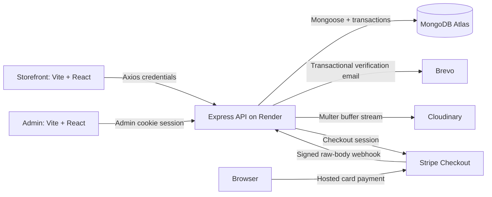

# FreshCart MERN Ecommerce

FreshCart is a MERN npm-workspaces monorepo with an Express/Mongoose API, a mobile-first React storefront, and a separate role-gated admin dashboard. It implements verified cookie authentication, catalog management, Cloudinary uploads, cart/address/order flows, COD and Stripe Checkout. It is a functional starter, not a production certification: read the [security review](docs/SECURITY.md) before launch.

**Deployment:** [Atlas + Render + two Vercel apps, Stripe webhook, and post-deploy checklist](docs/DEPLOYMENT.md).

**Portfolio:** [case study, screenshots, verified test evidence, and listing copy](docs/PORTFOLIO.md). **Maintenance:** [ownership boundaries, contributor workflow, scaling roadmap, and operations](docs/MAINTAINABILITY.md).

**Release automation:** [GitHub Actions quality checks](.github/workflows/ci.yml) and [Render API blueprint](render.yaml). Run `npm ci`, install Chromium with `npx playwright install chromium`, then run `npm run validate` for the complete local gate. Cloud deployment and live provider verification are separate requirements.

## Shared UI Theme

Both apps now use [the shared CSS variables](packages/design-system/theme.css), [Tailwind preset](packages/design-system/tailwind.config.js), and [reusable components](packages/design-system/src/components.jsx). App configs: [storefront](storefront/tailwind.config.js) and [admin](admin/tailwind.config.js).

The UI includes sticky search/mobile bottom navigation, cart drawers and quantity steppers, category chips, three-block checkout, timestamped order tracking, inline auth/verification forms, and a localStorage-safe 18+ hookah gate with a dark/gold theme. Admin has a collapsible dark sidebar, four real KPIs, searchable status-filtered order drawers, and drag/drop multi-image CRUD forms with primary-image selection.

See [the accessibility findings and fixes](docs/UI_ACCESSIBILITY.md), including WCAG-tagged scans and screenshots at 360px, 768px and 1280px. Browser checks use built production assets and explicit API fixtures, not a live database.

## Screenshots

These screenshots were captured by Playwright from the actual React apps with explicitly mocked API fixtures. Displayed products, customers and statistics are demonstration data, not live database or payment results.


More views: [mobile shop](docs/screenshots/storefront-mobile.png), [order detail drawer](docs/screenshots/admin-orders.png), and [multi-image product editor](docs/screenshots/admin-products.png).

## Architecture



The browser never holds a JWT in localStorage. Server data is cached by React Query; auth context/protected routes control navigation, while the API independently enforces authorization. All prices and inventory changes are server-controlled. MongoDB transactions coordinate checkout, payment inventory, and cancellation.

## Features

- Storefront: Home, Shop search/category/type filters, price sort and pagination, image gallery/product details, cart, saved delivery address, COD/Stripe checkout, order history, login/register and email verification.
- Admin: admin-only login, paid revenue/order stats, paginated orders with status controls and detail drawer, category/product CRUD, validated JSON attributes, multi-image previews/uploads, and deletion confirmation dialogs.
- Identity: bcrypt, hashed expiring one-use email tokens via Brevo, JWT HttpOnly cookies, revoking logout, database role checks, Zod validation and rate limits.
- Catalog: weighted MongoDB text search, safe filters and bounded pagination, optimistic writes, Cloudinary ownership metadata, signature-checked bounded memory uploads and delete-on-replace cleanup.
- Payments: USD card Checkout, stock reservation on session creation, signed raw webhook, transactional exactly-once stock deduction on completion, explicit cancellation and expiry cleanup. COD stock is deducted at order creation.
- UX: mobile-first green Tailwind styling, Lucide controls, credentialed Axios clients, React Query, loading/error/empty states, toasts and accessible dialogs.

## Demo Administrator

For a **local demo database only**, explicitly run `npm run seed:admin` after configuring `MONGODB_URI`:

| Field | Local Demo Value |
| --- | --- |
| Email | `admin@freshcart.test` |
| Password | `FreshCartDemo!2026` |
| Login URL | http://localhost:5174/login |

This account is not pre-created, not seeded by `npm run seed`, and not created at API startup. The provisioning command refuses these published credentials in production, preserves existing admins, and will not elevate an existing customer. For production, use private `DEMO_ADMIN_EMAIL`/`DEMO_ADMIN_PASSWORD` values in a trusted one-off job, then remove provisioning password variables. Do not expose a publicly editable production dashboard with demo credentials.

## Environment Table

Copy each workspace's `.env.example` to a local `.env` for development. Server secrets must never appear in frontend `VITE_*` values or Git.

| Variable | Location | Default / Purpose |
| --- | --- | --- |
| `NODE_ENV` | Server | `development`; use `production` on Render |
| `PORT` | Server | `5000`; Render supplies its port |
| `MONGODB_URI` | Server | Required MongoDB URI; Atlas/replica set required for transactions |
| `CORS_ORIGINS` | Server | Exact comma-separated storefront/admin origins |
| `API_PUBLIC_URL` | Server | API origin; HTTPS in production |
| `STOREFRONT_URL` | Server | `http://localhost:5173`; verification links and Stripe redirect origin |
| `JWT_SECRET` | Server secret | Required random secret, at least 32 bytes |
| `JWT_TTL_SECONDS` | Server | `86400`, allowed 60-604800 |
| `COOKIE_SAME_SITE` | Server | `lax`; `none` only in HTTPS production for cross-site cookies |
| `TRUST_PROXY` | Server | `0`; verified proxy-hop count 0-5 |
| `VERIFICATION_TOKEN_TTL_MINUTES` | Server | `60`, allowed 1-1440 |
| `BREVO_API_KEY` | Server secret | Required transactional API key |
| `BREVO_SENDER_EMAIL` | Server | Required verified sender |
| `BREVO_SENDER_NAME` | Server | `FreshCart` |
| `CLOUDINARY_CLOUD_NAME` | Server | Required Cloudinary cloud name |
| `CLOUDINARY_API_KEY` | Server secret | Required provider API key |
| `CLOUDINARY_API_SECRET` | Server secret | Required provider API secret |
| `CLOUDINARY_FOLDER` | Server | `freshcart`, slash-separated safe folder components |
| `STRIPE_SECRET_KEY` | Server secret | Stripe test/live key; blank with webhook secret disables cards |
| `STRIPE_WEBHOOK_SECRET` | Server secret | Signing secret for `/webhooks/stripe`; paired with Stripe key |
| `DEMO_ADMIN_EMAIL` | Provisioning only | Local default above; private value required for production |
| `DEMO_ADMIN_PASSWORD` | Provisioning secret | Local default above; private 16-72-byte value for production |
| `VITE_API_URL` | Storefront and admin | `http://localhost:5000/api`; production Render URL ending in `/api` |

## Automated Checks

```sh
npm run validate
npm test
npm run lint
npm run build
npx playwright install chromium
npm run test:browser
npm audit
```

Server tests include auth, total rounding, user isolation, COD rollback, admin transitions, upload limits, webhook signature/amount/owner checks, duplicate payment delivery, and cancellation/expiry. Browser tests cover storefront and admin workflows with API fixtures and refresh the checked-in screenshots. To use an existing Chromium binary, set `PLAYWRIGHT_CHROMIUM_EXECUTABLE` when running browser tests. Live provider/database tests remain a deployment/staging requirement.

## Requirements

- Node.js 22.12+ (Node.js 24 LTS is recommended via `.nvmrc`) and npm 10+.
- MongoDB Atlas or a MongoDB replica set for checkout transactions. A standalone MongoDB server can serve reads but cannot perform checkout transactions.
- A Brevo transactional API key and verified sender email.
- A Cloudinary account with cloud name, API key, and API secret.

## Setup

Run these commands from this directory:

```sh
npm install
cp server/.env.example server/.env
cp storefront/.env.example storefront/.env
cp admin/.env.example admin/.env
```

Set `MONGODB_URI`, `JWT_SECRET`, `BREVO_API_KEY`, `BREVO_SENDER_EMAIL`, `CLOUDINARY_CLOUD_NAME`, `CLOUDINARY_API_KEY`, and `CLOUDINARY_API_SECRET` in `server/.env`. Generate a JWT secret locally with:

```sh
node --input-type=module -e "import { randomBytes } from 'node:crypto'; console.log(randomBytes(32).toString('hex'))"
```

Keep JWT, Brevo, and Cloudinary secrets only in the server environment. Configure the other values described below, then run:

```sh
npm run dev
```

| Application | Development URL |
| --- | --- |
| API | http://localhost:5000/api/health |
| Storefront | http://localhost:5173 |
| Admin | http://localhost:5174 |

The API connects to MongoDB before listening. If it cannot connect, it exits with an error. `dev` stops the other processes when any application exits. To work on the frontends without MongoDB, run `npm run dev:storefront` and `npm run dev:admin` in separate terminals.

## Folder Structure

```text
freshcart-mern-ecommerce/
  .gitignore
  .npmrc
  .nvmrc
  eslint.config.js
  package.json
  package-lock.json
  README.md
  server/
    .env.example
    package.json
    src/
      app.js
      index.js
      auth/
        session.js
        tokens.js
        validation.js
      catalog/
        images.js
        validation.js
      commerce/
        rules.js
        transaction.js
        validation.js
      config/
        db.js
        env.js
      middleware/
        auth.js
        error-handler.js
        rate-limit.js
      models/
        User.js
        Category.js
        Product.js
        Cart.js
        Order.js
        address.js
      routes/
        auth.js
        categories.js
        cart.js
        orders.js
        payments.js
        products.js
        users.js
      scripts/
        seed.js
        seed-admin.js
      services/
        brevo.js
        cloudinary.js
        payments.js
    test/
      app.test.js
      auth-primitives.test.js
      auth.test.js
      catalog-validation.test.js
      catalog.test.js
      commerce-rules.test.js
      commerce.test.js
      models.test.js
      payments.test.js
  storefront/
    .gitignore
    .env.example
    index.html
    package.json
    vite.config.js
    public/                  # Local produce.jpg and generated Vite assets
    src/
      assets/                # Generated Vite assets
      main.jsx
      Storefront.jsx
      app.css
      pages/
        Catalog.jsx
        Account.jsx
        Commerce.jsx
      lib/
        api.js
  admin/
    .gitignore
    .env.example
    index.html
    package.json
    vite.config.js
    public/                  # Generated Vite assets
    src/
      assets/                # Generated Vite assets
      main.jsx
      Admin.jsx
      app.css
      pages/
        Overview.jsx
        Orders.jsx
        Management.jsx
      lib/
        api.js
        packages/
          design-system/
            package.json
            theme.css
            tailwind.config.js
            src/components.jsx
      ```

`node_modules/`, `dist/`, and real `.env` files are generated/local files and are ignored by Git. One root lockfile covers all workspaces; use `npm ci` for reproducible installs after cloning.

## Configuration Files

| File | Purpose |
| --- | --- |
| [package.json](package.json) | Private npm workspaces, shared tooling, commands, Node/npm minimums |
| [package-lock.json](package-lock.json) | Exact dependency resolution for all three applications |
| [.npmrc](.npmrc) | Reject unsupported Node/npm engines during install |
| [.nvmrc](.nvmrc) | Node.js 24 LTS |
| [.gitignore](.gitignore) | Exclude dependencies, builds, logs, and secrets; retain env examples |
| [eslint.config.js](eslint.config.js) | ESLint flat config, Node/browser globals, React Hooks and refresh rules |
| [server/package.json](server/package.json) | ES modules, Express, Mongoose, dotenv, CORS, Helmet, watch/test/start commands |
| [server/.env.example](server/.env.example) | API environment variables |
| [server/src/config/env.js](server/src/config/env.js) | Load the server-local `.env` independent of the working directory; validate variables |
| [server/src/config/db.js](server/src/config/db.js) | Mongoose connection settings |
| [server/src/app.js](server/src/app.js) | Helmet, environment-driven CORS, JSON limit, health/readiness routes, middleware order |
| [server/src/middleware/error-handler.js](server/src/middleware/error-handler.js) | Central errors and 404 responses |
| [server/src/auth/validation.js](server/src/auth/validation.js) | Strict Zod request schemas and validation middleware |
| [server/src/auth/session.js](server/src/auth/session.js) | JWT claims, host-only cookie settings, and public user fields |
| [server/src/middleware/rate-limit.js](server/src/middleware/rate-limit.js) | Auth endpoint rate limiter configuration |
| [server/src/services/brevo.js](server/src/services/brevo.js) | Brevo transactional API request and timeout |
| [server/src/catalog/validation.js](server/src/catalog/validation.js) | Catalog Zod schemas and safe search/filter/sort/pagination query construction |
| [server/src/catalog/images.js](server/src/catalog/images.js) | Multer memory storage, image limits, signature checks, and replacement cleanup |
| [server/src/services/cloudinary.js](server/src/services/cloudinary.js) | Buffered-image streaming to Cloudinary and owned-asset deletion |
| [server/src/commerce/validation.js](server/src/commerce/validation.js) | Strict cart/address/order schemas and bounded pagination for order history/admin lists |
| [server/src/commerce/rules.js](server/src/commerce/rules.js) | Price rounding to minor units, stock/age purchase checks, and allowed order status transitions |
| [storefront/package.json](storefront/package.json) | Storefront dependencies and scripts |
| [storefront/vite.config.js](storefront/vite.config.js) | React/Tailwind Vite plugins, development port 5173, preview port 4173 |
| [storefront/.env.example](storefront/.env.example) | Public API base URL |
| [storefront/.gitignore](storefront/.gitignore) | Vite workspace ignores |
| [storefront/index.html](storefront/index.html) | Storefront document and entry point |
| [storefront/src/app.css](storefront/src/app.css) | Shared Tailwind tokens and responsive storefront layout |
| [admin/package.json](admin/package.json) | Admin dependencies and scripts |
| [admin/vite.config.js](admin/vite.config.js) | React/Tailwind Vite plugins, development port 5174, preview port 4174 |
| [admin/.env.example](admin/.env.example) | Public API base URL |
| [admin/.gitignore](admin/.gitignore) | Vite workspace ignores |
| [admin/index.html](admin/index.html) | Admin document and entry point |
| [admin/src/app.css](admin/src/app.css) | Shared Tailwind tokens and responsive admin layout |

Tailwind v4 uses the Vite plugin, the shared CSS-first theme, and explicit `@config` imports of the app presets. No PostCSS configuration is needed. React Router's `BrowserRouter` is mounted in each application's `src/main.jsx`.

## Environment

### Server

```dotenv
NODE_ENV=development
PORT=5000
MONGODB_URI=mongodb://127.0.0.1:27017/freshcart
CORS_ORIGINS=http://localhost:5173,http://localhost:5174
API_PUBLIC_URL=http://localhost:5000
JWT_SECRET=
JWT_TTL_SECONDS=86400
VERIFICATION_TOKEN_TTL_MINUTES=60
BREVO_API_KEY=
BREVO_SENDER_EMAIL=
BREVO_SENDER_NAME=FreshCart
CLOUDINARY_CLOUD_NAME=
CLOUDINARY_API_KEY=
CLOUDINARY_API_SECRET=
CLOUDINARY_FOLDER=freshcart
STOREFRONT_URL=http://localhost:5173
COOKIE_SAME_SITE=lax
TRUST_PROXY=0
STRIPE_SECRET_KEY=
STRIPE_WEBHOOK_SECRET=
DEMO_ADMIN_EMAIL=
DEMO_ADMIN_PASSWORD=
```

`CORS_ORIGINS` is a comma-separated list of exact HTTP(S) origins. Paths, wildcards, and trailing slashes are invalid. An empty allowlist denies requests with an `Origin` header; originless requests such as server-to-server requests remain accepted. Credentialed requests and preflight are supported. `localhost` and `127.0.0.1` are different origins. For production, replace these entries with your actual HTTPS frontend origins. For local preview builds, add `http://localhost:4173` and `http://localhost:4174`.

`API_PUBLIC_URL` is the public API origin used in verification links, without a path or trailing slash; HTTPS is required when `NODE_ENV=production`. `JWT_SECRET` must contain at least 32 bytes of random secret material. Session lifetime defaults to 86400 seconds (allowed range 60-604800), and verification links expire after 60 minutes (allowed range 1-1440). Brevo credentials and sender email are required at startup; the example leaves them blank intentionally. Use a sender verified in your Brevo account.

Cloudinary credentials are also required at API startup. `CLOUDINARY_FOLDER` defaults to `freshcart` and accepts slash-separated alphanumeric, underscore, or hyphen components. Uploaded asset IDs use this namespace followed by the category/product ID and a server-generated UUID; never expose the API secret through a `VITE_*` variable.

### Storefront and Admin

Both applications use:

```dotenv
VITE_API_URL=http://localhost:5000/api
```

Vite embeds `VITE_*` values into public client bundles. Never place secrets in them. Restart Vite after changing local env files and rebuild when changing production values. Both credentialed Axios instances read this URL, with paths relative to `/api`, for example `api.get('/health')`.

## Commands

```sh
npm run dev              # All three apps
npm run dev:server       # API with Node's built-in watcher
npm run dev:storefront   # Storefront only
npm run dev:admin        # Admin only
npm run lint             # All workspaces, zero warnings
npm test                 # Server tests; no MongoDB needed
npm run build            # storefront/dist and admin/dist
npm run seed             # Non-destructive sample catalog; requires only MongoDB
npm run seed:admin       # Explicit local admin demo / guarded production provisioning
npm run test:browser     # Fixture-backed Playwright workflows and screenshots
npm start                # Production API; set NODE_ENV=production
npm run preview -w storefront
npm run preview -w admin
```

## Authentication

All routes live under `/api/auth` and return JSON. Request bodies must be JSON, and unknown fields are rejected by Zod. Both Axios clients use `withCredentials: true`.

| Method | Path | Input | Response |
| --- | --- | --- | --- |
| POST | `/register` | `{ name, email, password, ageConfirmed? }` | 202 with a generic message; creates an unverified user and sends a verification link |
| GET | `/verify-email?token=...` | Token from the email link | 200 on verification; 400 for malformed, expired, or already-used links |
| POST | `/login` | `{ email, password }` | 200 with `{ user }` and the session cookie; 401 for bad credentials; 403 until verified |
| POST | `/logout` | Auth cookie | 204, clears the cookie and invalidates all existing sessions for this account |
| GET | `/me` | Auth cookie | 200 with `{ user }`, or 401/403 |
| POST | `/resend-verification` | `{ email }` | 202 with a generic message, whether unknown, verified, cooling down, or eligible |

Passwords use bcrypt with cost 12. Validation requires 8-72 characters and at most 72 UTF-8 bytes to prevent bcrypt truncation. Registration can only create role `user`; privileged fields such as role, isVerified, passwordHash, and sessionVersion are rejected. Provision administrators through a trusted database/administrative process, not public registration.

Verification tokens contain 32 random bytes. Only their SHA-256 hashes, expiry times, and last-sent times are stored, hidden from default queries and user JSON. Verification atomically matches the hash and an unexpired, unverified account, then consumes the token. Resend atomically rotates the token after a 60-second cooldown, invalidating prior links. Expiry is checked at verification time; a TTL index is intentionally not used, so pending users are not deleted. On delivery failure the failed token and cooldown are cleared, the account remains pending, and the endpoint returns 503 so a resend can be attempted.

[Brevo delivery](server/src/services/brevo.js) uses `POST https://api.brevo.com/v3/smtp/email`, the server-only `api-key` header, configured sender, and a plain-text token link with a 10-second request timeout. The link opens the storefront's `/verify-email` page; confirming there consumes the API token. Do not log verification URLs, cookies, passwords, or API keys. See the [Brevo transactional API reference](https://developers.brevo.com/reference/sendtransacemail).

The `freshcart_session` cookie is httpOnly, host-only, scoped to `/api`, and Secure in production. `COOKIE_SAME_SITE=lax` is the development/same-site default; `none` uses None/Secure in production for unrelated frontend/API sites. JWTs use HS256 with issuer/audience checks, expiry, user subject and account session version; they are never returned in response JSON. Auth routes use `Cache-Control: no-store`. Logout invalidates copied sessions across all devices; logout without a valid session returns 401.

[requireAuth and requireAdmin](server/src/middleware/auth.js) are named middleware exports. `requireAuth` verifies the cookie and loads the current verified user into `req.user`; `requireAdmin` checks the current database role, not a client-supplied field or JWT role claim. Add protected routes before the existing not-found handler:

```js
import { requireAuth, requireAdmin, rejectCrossSiteMutation } from './middleware/auth.js'

app.get('/api/private', requireAuth, (req, res) => res.json({ userId: req.user.id }))
app.post('/api/admin/action', rejectCrossSiteMutation, requireAuth, requireAdmin, handler)
```

Auth mutations reject non-allowlisted Origins and cross-site Fetch Metadata. With None cookies, every mutation requires an explicit allowlisted Origin, including manual clients. Sibling HTTPS custom domains are recommended because browsers may block unrelated third-party cookies even with None/Secure. Keep mutation protections on future cookie-authenticated routes.

Auth has an overall IP limit of 100 requests per 15 minutes, plus registration 5/hour, login 10/15 minutes, resend 5/15 minutes, and verification 20/15 minutes. Limits return 429 with a consistent error response and standard rate/retry headers. The limiter uses an in-memory store per process; use a shared store when deploying multiple instances. Behind a reverse proxy, configure Express `trust proxy` for the exact trusted proxy topology before relying on IP limits; do not blindly set it to true.

The auth tests use actual bcrypt/JWT operations, Mongoose document validation, an in-memory user adapter, and mocked email delivery. They cover requests, cookies, session revocation, token expiry/replay/rotation, validation, roles, rate limiting, and Brevo request formatting. They do not verify MongoDB persistence/atomicity or live Brevo delivery; these require a configured database and Brevo account.

## Catalog API

Category and product reads are public. All writes and uploads require a verified administrator's session cookie and use the same mutation-origin protection as auth routes. JSON bodies are strict Zod schemas; image ownership metadata cannot be supplied by clients.

| Method | Path | Behavior |
| --- | --- | --- |
| GET | `/api/categories` | List categories sorted by name |
| GET | `/api/categories/:id` | Category detail |
| POST | `/api/categories` | Create category; body `{ name, slug, description? }` |
| PATCH | `/api/categories/:id` | Update one or more category fields |
| DELETE | `/api/categories/:id` | Delete category and its owned image; 409 if products still reference it |
| POST | `/api/categories/:id/image` | Replace category image; multipart field `image` |
| GET | `/api/products` | Searchable, filterable, sorted, paginated product list |
| GET | `/api/products/:id` | Product detail with category information |
| POST | `/api/products` | Create product; required `{ name, price, category }` |
| PATCH | `/api/products/:id` | Update one or more product fields |
| DELETE | `/api/products/:id` | Delete product and its owned Cloudinary images |
| POST | `/api/products/:id/images` | Replace the entire product image list; multipart field `images` repeated 1-5 times |

Product JSON writes accept `name`, `description`, `price`, `stock`, `category` (Category ObjectId), `productType` (`grocery` or `hookah`), and a JSON-object `attributes` field. Defaults are empty description/attributes, stock 0, and grocery type. Category existence is checked on product creation and category changes. Images are read-only in JSON writes: create the catalog record first, then call its upload endpoint. Empty/unknown-field updates are rejected; omitted fields are not reset. Updates use document validation and optimistic concurrency; overlapping writes can return 409 and must be retried against current data.

`GET /api/products` query parameters:

- `search`: nonempty text up to 200 characters, using the existing weighted MongoDB `$text` index.
- `category`: a category's 24-character ObjectId, not its slug.
- `productType`: optional `grocery` or `hookah` filter.
- `sort`: `price_asc`, `price_desc`, `newest`, or `relevance`. Default is relevance when searching, otherwise newest; explicit relevance requires search. Ties use `_id` for stable ordering.
- `page`: positive integer, default 1, maximum 10000.
- `limit`: positive integer, default 20, maximum 50.

The response is `{ products, pagination: { page, limit, total, pages } }`. Pages beyond the result set return an empty array; no results means `pages: 0`. Product responses expose image URLs and category data, never the private Cloudinary ownership IDs. Category responses use `{ categories }` or `{ category }`; single-product reads/writes use `{ product }`.

### Image Uploads

Multer buffers files in memory; no local upload directory is created. Authorization runs before multipart parsing. Each file must be JPEG, PNG, or WebP, at most 5 MB; both the declared MIME type and detected file signature must match. SVG/GIF, text fields, unexpected file fields, missing images, and excess files are rejected. Upload endpoints are limited to 20 requests per IP per 15 minutes per router. Oversized files return 413, unsupported images 415, and malformed multipart requests 400.

Validated buffers are streamed using `Readable` into Cloudinary's `upload_stream`. Assets use unique server-generated public IDs, no overwrite, and a 2000-by-2000 bounding transformation. Product uploads replace the full image list; category uploads replace its single image. New URLs/public IDs are saved first, then old owned assets are destroyed with CDN invalidation. External URLs or filenames are never converted into deletion IDs.

Failed/partial uploads or failed saves attempt to remove newly allocated assets, leaving old catalog URLs unchanged. Optimistic concurrency prevents an overlapping replacement from silently overwriting another save. Upload and deletion requests use 10-second provider timeouts. If cleanup fails after a database commit, the new URLs remain active and the response includes `cleanupFailed: true`; failed public IDs are logged for operator cleanup. Cleanup is best-effort, not a durable retry queue: retry deletion through Cloudinary using those logged IDs, and add an outbox/worker for guaranteed retries in production. Successful replacement returns `{ product, cleanupFailed: false }` or `{ category, cleanupFailed: false }`.

Successful record deletion returns 204. If the record was deleted but Cloudinary cleanup failed, it returns 200 with `{ message, cleanupFailed: true }`. Category-reference checks span separate MongoDB operations; transactions or a catalog-level locking strategy are needed to make category deletion/product creation races impossible across concurrent requests.

Example multipart upload after obtaining an administrator cookie jar:

```sh
curl -b cookies.txt -F 'images=@./photo.jpg' \
  http://localhost:5000/api/products/PRODUCT_ID/images
```

### Seed Data

Run from the monorepo root with a valid `MONGODB_URI` in the server environment:

```sh
npm run seed
```

[The seed script](server/src/scripts/seed.js) creates Groceries and Hookah Accessories categories with 10 grocery and 10 hookah accessory products. It waits for category/product indexes, uses category-slug upserts and deterministic product IDs, and only sets product values on insertion. Rerunning it does not delete existing records, duplicate seeded products, reset edited prices/stock, or remove uploaded images. Product images start empty; the seed does not call Cloudinary or create administrators. Unlike API startup, this command requires only MongoDB, not Brevo/JWT/Cloudinary settings.

Catalog tests exercise HTTP handlers with in-memory Mongoose document adapters, actual multipart parsing/signature detection, and mocked Cloudinary streams. They cover permissions, CRUD, query construction, pagination, reference checks, image replacement/rollback, conflicts, file limits, and repeatable seed data. Live MongoDB queries/index enforcement and Cloudinary operations require configured services and are not exercised by these tests.

## Cart, Address, and Orders API

All endpoints below require a verified signed-in user (`freshcart_session` cookie). Mutations also require same-site or allowlisted Origin checks.

| Method | Path | Behavior |
| --- | --- | --- |
| GET | `/api/cart` | Current user's cart with live product snapshots and computed totals |
| POST | `/api/cart/items` | Add quantity for a product (`{ productId, quantity? }`, default quantity `1`) |
| PATCH | `/api/cart/items/:productId` | Set exact quantity (`{ quantity }`) |
| DELETE | `/api/cart/items/:productId` | Remove one product from cart |
| DELETE | `/api/cart` | Clear all cart items |
| PUT | `/api/users/me/address` | Save shipping address for the signed-in user |
| POST | `/api/orders` | COD checkout from cart with server-side price/stock recalculation |
| GET | `/api/orders/history` | Current user's order history with pagination/status filter |
| GET | `/api/orders/admin` | Admin order list with pagination/status filter |
| PATCH | `/api/orders/admin/:id/status` | Admin status update with allowed transitions only |

### Cart Behavior

- Cart data is user-scoped by server-side session identity only; body/query ownership fields are rejected.
- Add increments existing quantity; update sets exact quantity.
- Quantity must be integer `1-999` and a cart can contain at most `100` distinct products.
- Server validates stock and age requirements (`hookah` requires `ageConfirmed`).
- Cart responses include per-item `lineTotal`, live product snapshot (or `null` if deleted), item `available`, and overall `total`.

### Address Save

- Address is validated with strict schema (`fullName`, `line1`, `city`, `country` required).
- Save replaces the current user address only and returns `{ address }`.

### COD Checkout

- `POST /api/orders` supports `paymentMethod: "cod"` or `"stripe"`. Stripe must be configured to create a card-payment order.
- Checkout recalculates prices server-side from current catalog values, rounds using decimal minor-unit math, and never trusts client totals.
- It verifies stock and purchase eligibility, snapshots product fields, creates the order, and clears the cart in a transaction. COD decrements stock immediately; Stripe reserves stock during Checkout session creation and deducts it only on a verified paid webhook.
- If any step fails (stock changed, product removed, persistence error), stock/cart changes roll back and no partial order is committed.
- Address comes from request body if provided, otherwise saved user address; missing both returns 400.

### Order History and Admin

- Customer history always filters by the authenticated user and cannot be overridden by query parameters.
- Admin list is global and requires `requireAdmin`.
- Pagination defaults to `page=1`, `limit=20`, max limit `50`.
- Optional status filter supports: `pending`, `confirmed`, `processing`, `shipped`, `delivered`, `cancelled`.

Allowed status transitions:

- `pending -> confirmed | cancelled`
- `confirmed -> processing | cancelled`
- `processing -> shipped | cancelled`
- `shipped -> delivered`
- `delivered` and `cancelled` are terminal

Additional status behavior:

- Reapplying the same status is idempotent.
- Moving to `delivered` marks COD payment status as `paid`.
- COD cancellation restores stock once in the same transaction. Unpaid Stripe orders cannot enter fulfillment, and paid Stripe cancellations require a refund workflow rather than the COD transition endpoint.

### Stripe Endpoints

| Method | Path | Purpose |
| --- | --- | --- |
| POST | `/api/orders/:id/checkout-session` | Owned pending Stripe order; reserves stock, returns hosted `url`/`sessionId` with provider idempotency |
| POST | `/api/orders/:id/cancel-payment` | Owned unpaid Stripe order; expires provider session and releases reservation |
| POST | `/webhooks/stripe` | Raw JSON body, Stripe signature verification, completion/expiry lifecycle |
| GET | `/api/orders/admin/stats` | Admin-only order count, pending count and paid revenue |

Card Checkout uses USD only and card-only payment methods. Signed completion validates session ID, owner, amount and currency; payment/stock changes are transactional and replay-safe. Expiry/cancel releases reservations once. Stripe Cancel redirects do not themselves cancel sessions; use the explicit Orders action or await expiry. Success redirects are not proof of payment. Provider creation timeouts preserve reservations for safe idempotent retry; monitor and reconcile stuck state as described in the security review.

Commerce tests cover validation, authorization, cart flows, address save, transactional checkout rollback, customer history isolation, admin transition rules, and stock restoration on cancellation. Live MongoDB transaction behavior is still environment-dependent and should be validated in integration/staging.

## Data Models

All five models are default ES-module exports and enable `createdAt`/`updatedAt` timestamps.

| Model | Fields and behavior |
| --- | --- |
| [User](server/src/models/User.js) | Required name, normalized unique email, and passwordHash; role `user` (default) or `admin`; isVerified and ageConfirmed default false; optional address. Hidden verification token hash/expiry/last-sent state and sessionVersion support email verification and session revocation. All credential/token/session fields are removed from document JSON. |
| [Category](server/src/models/Category.js) | Required name and unique lowercase hyphenated slug; optional description/image, hidden imagePublicId, and optimistic concurrency for updates. |
| [Product](server/src/models/Product.js) | Name, description, finite nonnegative price, nonnegative integer stock, images array, required Category reference, productType `grocery` (default) or `hookah`, flexible plain-object attributes, hidden imageAssets ownership metadata, and optimistic concurrency for updates. |
| [Cart](server/src/models/Cart.js) | Unique required User reference; items contain Product references and positive integer quantities. Empty carts are permitted, duplicate product entries are rejected. |
| [Order](server/src/models/Order.js) | Required User reference, nonempty item snapshots, address snapshot, paymentMethod `cod` or `stripe`, paymentStatus, orderStatus, and finite nonnegative total. |

The shared [address schema](server/src/models/address.js) requires `fullName`, `line1`, `city`, and `country`; `phone`, `line2`, `state`, and `postalCode` are optional. Embedded addresses and cart/order items have no separate `_id`.

Order items snapshot `name`, unit `price`, `quantity`, `productType`, optional `image`, and `attributes` alongside the original Product reference. They do not depend on populating live product details. Checkout code must read trusted catalog data, clone attributes (for example, `structuredClone(product.attributes)`), copy the customer's address, and calculate the final total server-side. The schema does not automatically build snapshots, recalculate totals, reserve stock, or enforce payment/status transitions.

- Payment statuses: `pending` (default), `paid`, `failed`, `refunded`.
- Order statuses: `pending` (default), `confirmed`, `processing`, `shipped`, `delivered`, `cancelled`.
- Product text search uses one weighted text index over `name` (weight 10) and `description` (weight 2), plus a category/productType filter index. Use `Product.find({ $text: { $search: 'fresh apples' } })` for MongoDB text search.
- Order history is indexed by `user` and descending `createdAt`. Unique indexes enforce email, category slug, and one cart per user once MongoDB has built them; `unique` is not a Mongoose validator. ObjectId references do not enforce foreign-key existence.
- API startup awaits User/Category/Product/Cart/Order index initialization before listening; seed startup awaits Category/Product indexes. Await `Model.init()` when database-backed tests need indexes to exist; manage large production index changes explicitly during deployment.
- Product and order-item attributes use `Mixed` for flexible nested values. For in-place changes, call `product.markModified('attributes')` or `order.markModified('items')` before saving. Query updates require `{ runValidators: true }`, and validators do not enforce every atomic update operator; validate complete documents for cart and checkout changes.
- Auth routes hash passwords before storing them and explicitly select `+passwordHash` only when verifying credentials. Future controllers must control role/verification updates and enforce age requirements; `ageConfirmed` records a declaration, not verified age evidence.

The model tests validate documents and declared indexes without a database. Actual uniqueness enforcement, reference population, persistence, and `$text` queries require MongoDB and are not covered by this database-free suite.

## API and Deployment Notes

- `GET /api/health` is a liveness endpoint. `GET /api/ready` returns 503 if MongoDB is disconnected.
- Errors have the shape `{ "error": { "message": "..." } }`. Non-production errors also include a stack; production 5xx errors hide internal details. Mongoose validation/cast errors map to 400, duplicate keys/version conflicts to 409, oversized multipart files to 413, and unknown routes to 404.
- Helmet is enabled before CORS; JSON bodies are limited to 100 KB. The API closes its HTTP listener and MongoDB connection on SIGINT/SIGTERM.
- Host `storefront/dist` and `admin/dist` separately. Configure each host to rewrite unknown frontend paths to `index.html` for React Router. Vite preview is for local inspection, not production hosting.
- CORS is not authentication or CSRF protection. Reuse auth/admin middleware, mutation-origin protection and rate limits on future routes, and follow the documented remaining launch risks. The admin UI only exposes privileged server operations after role checks.
- The local storefront starter image (`storefront/public/produce.jpg`) comes from [Unsplash](https://unsplash.com/photos/92c53300491e). Replace it with your own product imagery when adding the catalog.