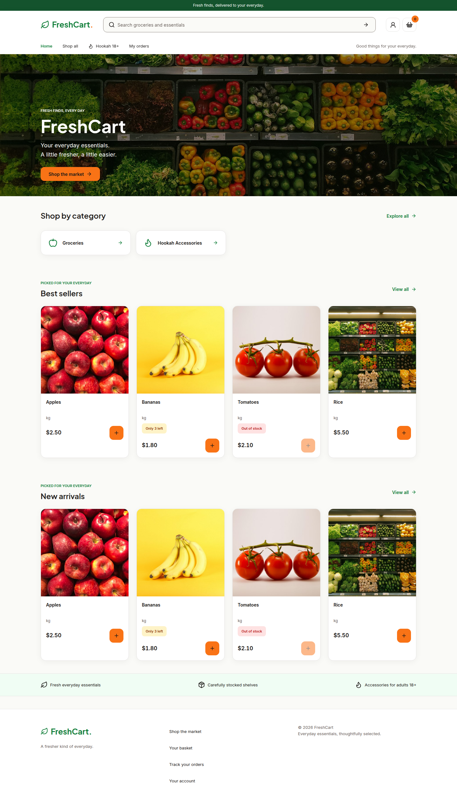
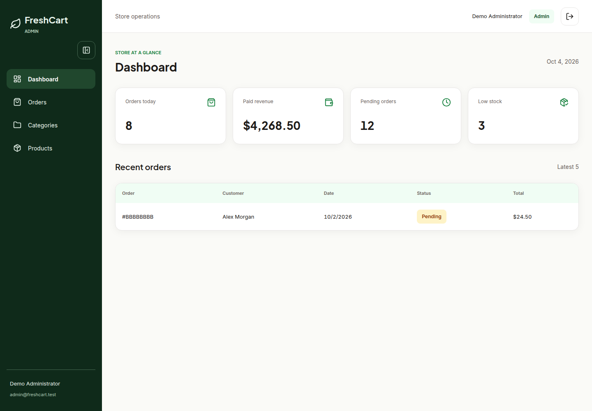

# FreshCart: MERN Commerce Case Study

**Repository:** https://github.com/solenova0/freshcart-mern-ecommerce

**Portfolio repository:** https://github.com/solenova0/solan-portfolio

**Published case study:** https://solan-portfolio.vercel.app/case-study/freshcart

## Project Summary

FreshCart is a full-stack commerce application with a React storefront, separate role-gated React administration app, and an Express/Mongoose API. It brings catalog discovery, verified accounts, cart and address management, cash-on-delivery orders, and Stripe Checkout into one npm-workspaces repository.

The engineering focus is trustworthy server-side commerce decisions, explicit security boundaries, reusable UI, and reproducible verification. This is a portfolio implementation, not a claim of production certification or measured scale.

## Demonstration

Screenshots show actual React applications with mocked API fixtures. Customers, products, and statistics are demonstration data. Live deployment URLs must be added only after deployment and staging checks succeed.

Suggested walkthrough: search and filter products, inspect product details, sign in, update a cart, choose a delivery address, place a COD order, then review order status and catalog management in the admin application. Stripe requires configured test-mode services; the browser fixture does not process a real payment.

## Engineering Highlights

- **Commerce integrity:** server-owned pricing, decimal-safe totals, transactional stock changes, Stripe reservations, signed webhook validation, and duplicate-event protection.
- **Authentication boundaries:** hashed passwords, one-use verification tokens, HttpOnly cookie sessions, revoking logout, database-enforced roles, and exact credentialed origins.
- **Maintainable structure:** domain validation/rules separated from HTTP routes, injected provider/test adapters, separate customer/operator apps, and a shared design-system workspace.
- **Usable interfaces:** responsive shopping and administration workflows, explicit loading/error/empty states, accessible dialogs, and keyboard-aware controls.
- **Release discipline:** one `npm run validate` gate, a two-version GitHub Actions workflow, a Render blueprint, and documented production checks.

## Verification Evidence

Local verification performed on October 4, 2026:

| Check | Result |
| --- | --- |
| ESLint | Passed with zero warnings |
| Backend tests | 97 passed |
| Frontend production builds | Storefront and admin passed |
| Playwright | 13 passed, including accessibility and responsive geometry at 360, 768, and 1280 pixels |
| Runtime dependency audit | No reported vulnerabilities at verification time |

Backend tests use adapters and browser tests use API fixtures. Real Atlas transactions, provider integrations, deployed cookies, and cloud health still require the [staging checklist](DEPLOYMENT.md). Results are point-in-time evidence, not permanent guarantees.

## Portfolio Listing Copy

**FreshCart | Full-Stack MERN Ecommerce**

Built a React storefront and role-gated admin dashboard backed by an Express/MongoDB API. Implemented verified cookie authentication, catalog and image management, transactional checkout, and Stripe webhook-driven inventory updates. Organized shared UI and domain rules in an npm-workspaces monorepo, with backend tests, responsive/accessibility browser checks, and documented deployment and scaling decisions.

**Stack:** React, Vite, Tailwind CSS, React Query, Node.js, Express, MongoDB/Mongoose, Stripe, Cloudinary, Brevo, Playwright, GitHub Actions.

**Links:** source repository above; add verified storefront/admin URLs after deployment. Do not publish private administrator credentials.

## Tradeoffs and Next Steps

The modular monolith avoids distributed-service overhead while keeping ownership boundaries clear. Before live transactional use, prioritize durable payment/asset reconciliation, shared rate limits for multiple API instances, request-level COD idempotency, refund/dispute handling, and stronger account recovery/admin controls. See [architecture and scaling](MAINTAINABILITY.md) and [the security review](SECURITY.md).